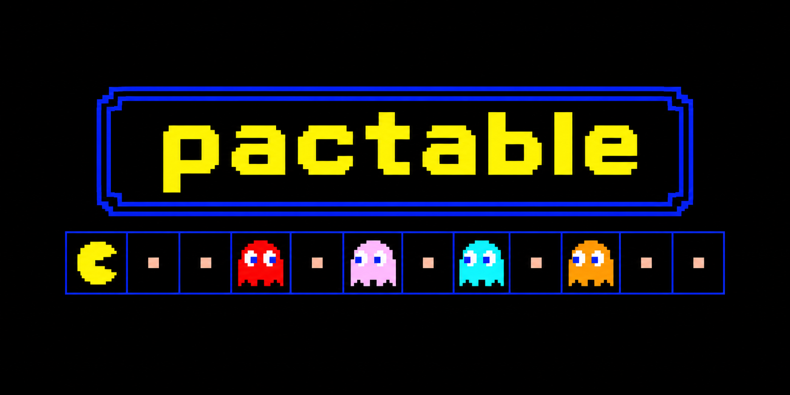

# pactable

> An arcade-faithful 1980 Pac-Man engine rendered inside a React data table.

## Vision

The goal of pactable is to run a real-time arcade game loop inside a standard 31x28 HTML data table (868 cells) without frame drops or full-table re-renders.

Instead of a `<canvas>` element or external media assets, every tile is a table cell managed by TanStack Table, every sprite is an inline SVG, and every sound is synthesized in real time.

## Features

### Engine & rendering

- **27-bit state packing** - Encodes tile type, wall flash, energizer blink, Pac-Man state, ghost state, fruit/score overlays, and wall cache version into a single primitive integer per cell.
- **Static table shell** - The outer data table mounts once with frozen row definitions and never re-renders during gameplay.
- **Two-phase collision detection** - Evaluates entity collisions after Pac-Man steps and again after ghosts step to prevent head-on tile swapping.
- **Input buffering** - Queues directional inputs before intersections and executes turns on the exact tick a corridor opens.
- **Wrap-around tunnel** - Horizontal traversal across the row 14 side tunnels.

### Ghost AI

- **Blinky (Shadow)** - Targets Pac-Man's exact coordinates and enters "Cruise Elroy" mode to ignore scatter waves when remaining pellets drop below the level threshold.
- **Pinky (Speedy)** - Targets 4 tiles ahead of Pac-Man, reproducing the original ROM hex-addition overflow that offsets the target 4 tiles up and 4 tiles left when Pac-Man faces up.
- **Inky (Bashful)** - Computes an intermediate pivot 2 tiles ahead of Pac-Man (including the upward overflow) and doubles the vector from Blinky's position through that pivot.
- **Clyde (Pokey)** - Chases Pac-Man when 8 or more tiles away and retreats to the bottom-left corner when closer.
- **Canonical intersection rules** - Enforces deterministic direction priority (`UP > LEFT > DOWN > RIGHT`) and blocks upward turns at the 4 canonical maze intersections.

### Audio & visuals

- **Custom Fourier waveforms** - Uses `PeriodicWave` harmonic arrays to replicate the hollow and lead timbres of the arcade sound chip.
- **Two-voice intro score** - Synthesizes synchronized lead and bass channels for the start melody and level-clear fanfare.
- **Dynamic wall auto-tiling** - Computes outer borders, convex corners, and concave inner corners from cardinal and diagonal neighbor states.
- **Score popups & overlays** - In-cell rendering for bonus fruits, compounding ghost combo scores (200 to 1600), and arcade status banners.

### Level specifications

| Level | Bonus Fruit | Fruit Points | Frightened Duration | Elroy Threshold | Tick Interval |
| :---: | :---------: | :----------: | :-----------------: | :-------------: | :-----------: |
|   1   |   Cherry    |     100      |         6s          |   <= 20 dots    |     165ms     |
|   2   | Strawberry  |     300      |         5s          |   <= 30 dots    |     148ms     |
|   3   |    Peach    |     500      |         4s          |   <= 40 dots    |     148ms     |
|   4   |    Peach    |     500      |         3s          |   <= 40 dots    |     148ms     |
|   5   |    Apple    |     700      |         2s          |   <= 40 dots    |     132ms     |

## Controls

| Input                  | Action                                 |
| ---------------------- | -------------------------------------- |
| `Arrow Keys` / `WASD`  | Buffer next movement direction         |
| `Space` / `P`          | Pause or resume game                   |
| `L1`–`L5` DIP switches | Jump to level while preserving score   |
| Cabinet buttons        | Toggle pause, reset 1UP, or mute audio |
